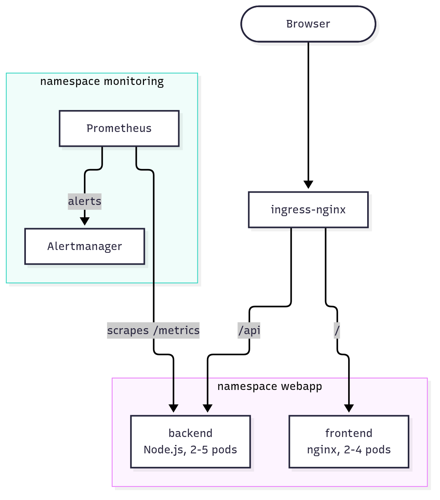
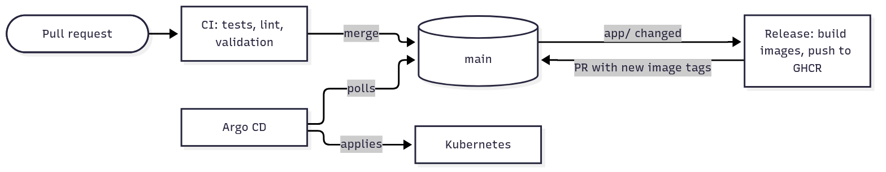

# cloud-native-webapp-k8s

Cloud native production environment for a web application on Kubernetes with scaling, security, GitOps deployment, CI/CD and monitoring.

## Architecture





| Requirement | Implementation | Where |
|---|---|---|
| Deployments, Services, Ingress | Helm chart, ClusterIP services, ingress-nginx | `helm/webapp/` |
| ConfigMap and Secret | ConfigMap for the message, admin token as SealedSecret | `helm/webapp/`, `cluster/admin-token.yaml` |
| RBAC | read-only developer role without secrets | `cluster/rbac.yaml` |
| NetworkPolicy | default deny, explicit allows | `cluster/networkpolicy.yaml`, `helm/webapp/templates/networkpolicy.yaml` |
| GitOps | Argo CD, app of apps | `gitops/` |
| CI/CD | GitHub Actions, GHCR | `.github/workflows/` |
| Monitoring | kube-prometheus-stack, ServiceMonitor, alert rules | `gitops/apps/monitoring.yaml`, `helm/webapp/templates/` |

## Repository structure

```
.
├── app/                  backend (Node.js) and frontend (nginx)
├── helm/webapp/          Helm chart for both components
├── cluster/              namespace, network policies, RBAC, sealed admin token (Kustomize)
├── gitops/
│   ├── argocd/           Argo CD installation
│   ├── root.yaml         app of apps, the only manifest applied by hand
│   └── apps/             sealed-secrets, webapp-cluster, webapp, monitoring
└── .github/workflows/    CI and release pipelines
```

## Installation

Requires minikube 1.39, kubectl and Docker. The cluster needs about 4 CPUs and 6 GB of memory.

```bash
minikube start --cni=calico --cpus=4 --memory=6144
minikube addons enable ingress
minikube addons enable metrics-server

kubectl apply -k gitops/argocd --server-side
kubectl wait --for=condition=Established crd/applications.argoproj.io
kubectl apply -f gitops/root.yaml
kubectl get applications -n argocd
```

Calico is needed because the default minikube CNI does not enforce NetworkPolicy. After a few minutes all applications should be `Synced` and `Healthy`.

The committed SealedSecret can only be decrypted by the cluster it was created for. On a new cluster, create the admin token directly once the namespace exists:

```bash
kubectl create secret generic webapp-admin-token -n webapp --from-literal=ADMIN_TOKEN="$(openssl rand -hex 24)"
```

Access to applications:

| What | Port-forward | URL |
|---|---|---|
| Application | `kubectl port-forward -n ingress-nginx svc/ingress-nginx-controller 8080:80` | http://localhost:8080 |
| Argo CD | `kubectl port-forward -n argocd svc/argocd-server 8443:443` | https://localhost:8443, user `admin`, password in `argocd-initial-admin-secret` |
| Prometheus | `kubectl port-forward -n monitoring svc/monitoring-kube-prometheus-prometheus 9090` | http://localhost:9090 |
| Alertmanager | `kubectl port-forward -n monitoring svc/monitoring-kube-prometheus-alertmanager 9093` | http://localhost:9093 |

## Usage and verification

```bash
curl -H 'Host: webapp.local' http://localhost:8080/api/info
# {"message":"Hello from Kubernetes","version":"5e20b0b","hostname":"webapp-backend-6bc997b46b-5sxc8"}
```

`version` is the deployed image tag and `hostname` changes between calls because requests are balanced across pods.

A change merged to `main`, for example `backend.config.message` in `values.yaml`, is deployed by Argo CD within a few minutes. Manual changes are reverted, a deleted deployment comes back within seconds.

Pull requests run tests, hadolint, image builds, `helm lint` and kubeconform. A merge that changes `app/` builds the changed images, pushes them to GHCR with the commit SHA as tag and opens a pull request with the new tags. Merging it deploys the new version.

**Security.**

```bash
# another namespace cannot reach the backend (times out)
kubectl run np-test -n default --rm -i --restart=Never --image=busybox:1.37 -- wget -q -T 5 -O- http://webapp-backend.webapp/api/info
# Pod Security Admission rejects a root container
kubectl run psa-test -n webapp --image=nginx:1.30-alpine
# the developer role cannot read secrets
kubectl auth can-i get secrets -n webapp --as=jane --as-group=webapp-developers
```

**Alerts.**

| Alert | Condition | Severity |
|---|---|---|
| WebappPodNotReady | pod not ready for 5 minutes | warning |
| WebappPodCrashLooping | container in CrashLoopBackOff for 5 minutes | critical |
| WebappHighErrorRate | more than 5% of `/api` requests return 5xx for 2 minutes | critical |
| WebappHighCpuUsage | pod above 80% of its CPU limit for 10 minutes | warning |

The admin endpoint returns 500 on purpose. Calling it for a few minutes fires `WebappHighErrorRate` in Prometheus and Alertmanager:

```bash
TOKEN=$(kubectl get secret webapp-admin-token -n webapp -o jsonpath='{.data.ADMIN_TOKEN}' | base64 -d)
for i in $(seq 300); do curl -s -o /dev/null -H 'Host: webapp.local' -H "Authorization: Bearer $TOKEN" http://localhost:8080/api/admin/error; sleep 1; done
```
